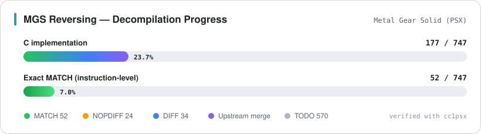
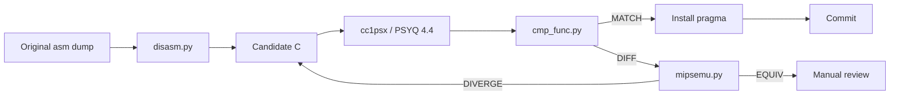

# 🎮 MGS Reversing — Decompilation Progress

[](docs/progress.svg)
[](#-decompiled-functions-match)
[](#)
[](#)
[](https://github.com/FoxdieTeam/mgs_reversing)

> Reverse-engineering **Metal Gear Solid (1998, PSX)**.  
> Goal: decompile every remaining overlay function from
> [`FoxdieTeam/mgs_reversing`](https://github.com/FoxdieTeam/mgs_reversing)
> into C, verified instruction-by-instruction with `cc1psx` (PSYQ 4.4).

**Quick links:** [Progress](#-progress) · [Methodology](#-methodology) ·
[Tools](#-tools) · [Repository](#-repository-structure) ·
[Decompiled](#-decompiled-functions-match) · [Build](#-build--verify) ·
[Work log](WORKLOG.md)

---

## 📊 Progress



| Status | Count | Description |
|:---|---:|:---|
| ✅ **MATCH** | 52+ | Exact instruction-level match with `cc1psx` (my verified) |
| ⚠️ **NOPDIFF** | 24 | Decompiled, but original had `nop` in delay slots (MATCH impossible) |
| 🔶 **DIFF** | 34 | Decompiled, schedule/codegen differences only (semantically equivalent) |
| 📝 **C total** | **191** | Functions with a C implementation (incl. upstream merge) |
| 🔧 **TODO** | **556** | Still in assembly (`#pragma INCLUDE_ASM`) |
| **Total** | **747** | Functions in the dump |

> After the **Nov 8 upstream merge** (FoxdieTeam `master`), 191 functions are in C.
> My own verified contributions: **52 MATCH · 24 NOPDIFF · 34 DIFF**.

---

## 🧪 Methodology



1. **Compiler verification, not eyeballing** — every candidate is compiled with
   `cc1psx` and compared instruction-by-instruction against the original dump.
   Only exact matches enable the pragma substitution.
2. **Differential emulation** — `mipsemu.py` runs both original and rebuilt dumps
   on a MIPS emulator and compares effects (`EQUIV` ≠ `MATCH`: `EQUIV` alone
   does **not** enable the pragma).
3. **Find the twin** — the winning method: locate an already-decompiled function
   with the same idiom in another overlay/module and reuse its types/patterns.
4. **Measure, don't guess** — `variants.py` / `trybody.py` enumerate plausible
   forms and measure them.
5. **Quality before volume** — no pragma substitution unless exact.

### Key findings

- **95% of candidates are blocked on data symbols**, not code. The data segment
  is laid out by declaration order, so adding a symbol shifts everything after it.
- **Register allocation** is the real obstacle: correct logic, but `cc1psx`
  allocates registers differently from Konami's compiler.
- **Addresses are per-overlay**: the same address means different things in
  different overlays. Every comparison must be scoped.
- **`volatile` on structs**: approved but unused (single justified exception:
  `s14e_800C9A68`).

---

## 🛠️ Tools

| Tool | Purpose |
|:---|:---|
| `mipsemu.py` | Differential MIPS emulator (selftest before trusting verdicts) |
| `cmp_func.py` | Instruction-level comparison (normalizes notation, symbols, macros) |
| `ready.py` | Filters candidates whose external refs are all known symbols |
| `rank_match.py` | Ranks candidates by delay-slot risk |
| `audit.py` | Runs the emulator on all already-decompiled C functions |
| `match.sh` | Installs candidate → builds → compares → restores |
| `trybody.py` / `variants.py` | Enumerate and measure plausible implementations |
| `mkelf.py` | Rebuilds an overlay dump into an ELF32 MIPS image for REA/Ghidra |

### `cmp_func.py` normalizations (extended)

- `li` with zero low half
- `jal $31,reg` → `jalr`
- `lui`+`ori` / `lui`+`addiu` fold (incl. different destination register)
- `lui`+`lw` and `lui`+`addiu`/`ori` separated by up to 4 instructions
- Calls to overlay-local symbols `<overlay>_<address>` compared by encoded address

---

## 📁 Repository Structure

```
work/
├── mgs_rev2/              # Main repo (branch: decompile-overlays)
│   ├── source/
│   │   ├── overlays/      # s14e, s07b, s08b, rank, brf, s11g, s11d, ...
│   │   ├── libdg/         # DG (display) library
│   │   ├── libhzd/        # HZD (collision) library
│   │   └── ...
│   └── build/             # ninja build system
├── mipsemu.py             # Differential emulator
├── cmp_func.py            # Instruction comparison
├── ready.py               # Candidate filter
├── rank_match.py          # Candidate ranking
├── audit.py               # Equivalence audit
├── match.sh               # Build/compare/restore
├── WORKLOG.md             # Detailed work log
└── README.md              # This file
```

---

## 🏆 Decompiled Functions (MATCH)

| Function | Overlay | Notes |
|:---|:---|:---|
| `s14e_800C5960` | s14e | Twin of `FreeModel`. Inline object array at `DG_OBJS+0x48`. |
| `s14e_800C5958` | s14e | Empty (`nop`). |
| `rank_800CD1A8` | rank | TRadioFileModeFn. |
| `rank_800CCF64` | rank | Guard: `GV_DestroyActor` inside `rank_dword_800E1878 >= 0`. |
| `rank_800D12D0` | rank | Fills two menu primitives. |
| `s14e_800CD184` | s14e | HZD_GetAddress/ReachTo + `s14e_800CD0FC`. |
| `s08b_bunsin2_800D0784` | s08b | HZD re-seat + counter. |
| `s08b_bunsin2_800CEA34` | s08b | HZD_FarZoneNavigate + GetRoute. |
| `s07b_800CBAA4` | s07b | `GV_SubVec3` + `GV_VecDir2` angle classification. |
| `s07b_800CB224` | s07b | Yaw from global SVECTOR at `0x800ABA10`. |
| `s07b_800C4FB8` | s07b | `DG_OBJ[4]` + `DG_MovePos` + `ReadRotMatrix` + `AN_SocomFlash`. |
| `s07b_800C54C0` / `54E8` | s07b | Shadow enable/disable helpers. |
| `s14e_800CA2E4` | s14e | Blood splash matrix (twin of `s07b_800C4F50`). |
| `s08b_bunsin2_800CD614` | s08b | Muzzle flash on `DG_OBJ[4]`. |
| `s08b_bunsin2_800CD770` | s08b | `RotMatrix` for floor light prim. |
| `s14e_800C82D0` | s14e | Copies `data_800AB9F4[1]` into `control.turn`. |
| `s08b_bunsin2_800CE21C` | s08b | Direction table lookup by `GV_Clock % 4`. |
| `s08b_bunsin2_800CD808` | s08b | Counter 0x800C3438, re-arms the actor. |
| `s14e_800C6F94` | s14e | `ratan2` pitch + `GV_NearExp8` smoothing. |
| `s14e_800C6AC0` | s14e | `int m; m = work->target->damaged & TARGET_DOWN; return m != 0;` |

> Full list with instruction counts in [`WORKLOG.md`](WORKLOG.md).

### ✨ Recent additions (this fork)

| Function | Overlay | Status | Notes |
|:---|:---|:---|:---|
| `s07b_800C5490` | s07b | ✅ | Global -2 latch |
| `s07b_800CC9E8` | s07b | ✅ | Shadow bit + `& 0xFF6B` |
| `s07b_800CBDA0` | s07b | ✅ | `field_850 & 4`, pitch delta |
| `s07b_800CC6CC` | s07b | ✅ | Six dwords to -1 |
| `s07b_800CC89C` | s07b | ✅ | Message code 1 → `0x8001FF2C` |
| `s07b_800CC138` | s07b | ✅ | Buffer + `0x80016504` |
| `s07b_800CC67C` | s07b | ✅ | `"attack end\n"` printf |
| `s07b_800CC8D4` | s07b | ✅ | `field_28 \|= / &= ~0x80` |
| `s07b_800CC930` | s07b | ✅ | Two flags to 1 |
| `s07b_800CCBB0` | s07b | ✅ | Clear + mask + SVECTOR copy |
| `s07b_800D0A4C` | s07b | ✅ | Thin wrapper |
| `s08b_bunsin2_800D08C8` | s08b | ✅ | r0/r1/r2 probe logic |
| `s08b_bunsin2_800D12A0` | s08b | ✅ | 301-frame counter |
| `s08b_bunsin2_800D53E8` | s08b | ✅ | One-shot timer |
| `s08b_bunsin2_800D0F88` | s08b | ✅ | Timer with `field_19D0` thresholds |
| `s08b_bunsin2_800CAF6C` | s08b | ✅ | `action2` reset on `field_19B0 != 0x16` |
| `s08b_bunsin2_800CB210` | s08b | ✅ | `field_1A00 = 1`, reset on `!= 0x1B` |
| `s08b_bunsin2_800CE180` | s08b | ✅ | SVECTOR table + `HZD_GetAddress` |
| `s08b_bunsin2_800CE800` | s08b | ✅ | Yaw → switch 0–3 |
| `s08b_bunsin2_800CF660` | s08b | ✅ | Switch on `field_1A34` |
| `s08b_bunsin2_800CCA4C` | s08b | ✅ | `GM_SeSetMode` at `arg == 0x3C` |
| `s08b_bunsin2_800CAFF8` | s08b | ✅ | `target \|= 0x1F`, `!= 0x17` |
| `s08b_bunsin2_800CB0A8` | s08b | ✅ | `target \|= 0x1F`, `!= 0x18` |
| `s08b_bunsin2_800CB158` | s08b | ✅ | `s08b_800C9548`, `!= 0x1A` |
| `s08b_bunsin2_800CB38C` | s08b | ✅ | `!= 0x1E`, `target \|= 0x1F` |
| `s08b_bunsin2_800CB2AC` | s08b | ✅ | `GM_SeSetMode 0xB7`, `!= 0x1C` |
| `s08b_bunsin2_800CB444` | s08b | ✅ | Variant with `s08b_800C9548`, `!= 0x1D` |
| `brf_800DDC40` | brf | ✅ | Actor dispatch + table call |
| `brf_800CEC68` / `brf_800CDF34` | brf | ✅ | switch on `field_ADA4` |
| `s14e_800CA538` | s14e | ✅ | `GM_SeSet` 0xA0–0xA6 |

---

## 🚫 Blocked Examples

| Function | Blocker |
|:---|:---|
| `s14e_800CD6C4` | Global at 0x800DD7AC in unmodeled gap. |
| `s07b_800CDA04` | 7-byte copy via lwl/lwr, needs 7-byte type. |
| `rank_800CC19C` | Missing main-exe symbols. |
| `s11d_hind_800CAFEC` | `andi 0xffff` folded by cc1psx. |
| `brf_800DDC40` | Scheduler coin flip (lui in load-delay slot). |

## 🔧 NOPDIFF (MATCH impossible)

10 functions whose original has a `nop` in a delay slot — cc1psx fills those
slots, so the streams can never be identical, but the C is semantically
equivalent:

`s07b_800C4F50` · `s07b_800C5514` · `s07b_800CB068` · `s14e_800C6028` ·
`s14e_800C6E08` · `s14e_800CA49C` · `s14e_800CADD0` · `s14e_800CA90C` ·
`s14e_800CA998` · `rank_800D0A24/0A70/0ABC/0B08` (family)

---

## 🔨 Build & Verify

```bash
# Build
cd work/mgs_rev2/build
/Users/fury/mgsvenv/bin/ninja ../obj/<path>.asm

# Instruction-level comparison
python cmp_func.py orig_<sym>.s mgs_rev2/obj/<path>.asm <sym> mgs_rev2/build/functions.txt

# Differential emulation
python mipsemu.py orig_<sym>.s mgs_rev2/obj/<path>.asm <sym> --trials 300

# Emulator selftest (run before trusting verdicts)
python mipsemu.py --selftest
```

---

## 📜 Work Log

Full detailed log in [`WORKLOG.md`](WORKLOG.md) (67 timestamped sessions,
navigable index at the top).

## 🔗 Upstream & Credits

| | |
|:---|:---|
| **Base project** | [`FoxdieTeam/mgs_reversing`](https://github.com/FoxdieTeam/mgs_reversing) |
| **This fork / tracker** | [`FuryKid78543/mgs-reversing-progress`](https://github.com/FuryKid78543/mgs-reversing-progress) |
| **Compiler** | `cc1psx` from PSYQ 4.4 |
| **Special thanks** | FoxdieTeam, millerkazuhira, GirianSeed, nicoSWD and all upstream contributors |

---

<div align="center">
<sub>Metal Gear Solid © Konami. This project is a non-commercial reverse-engineering
effort for preservation and research purposes.</sub>
</div>
